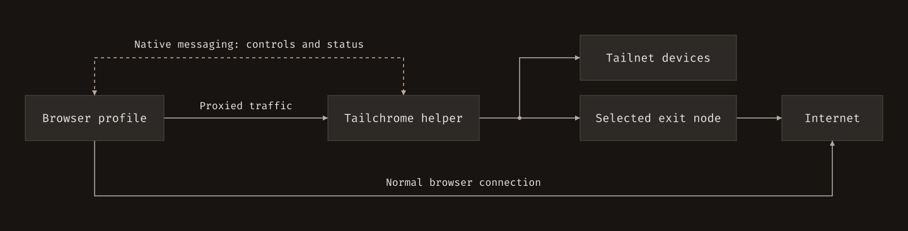
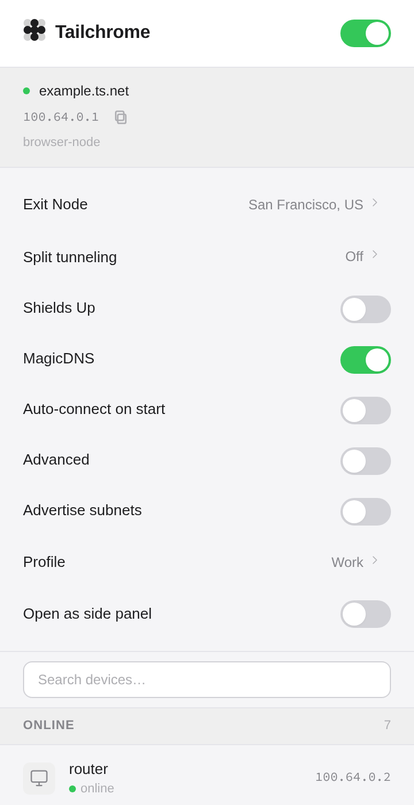
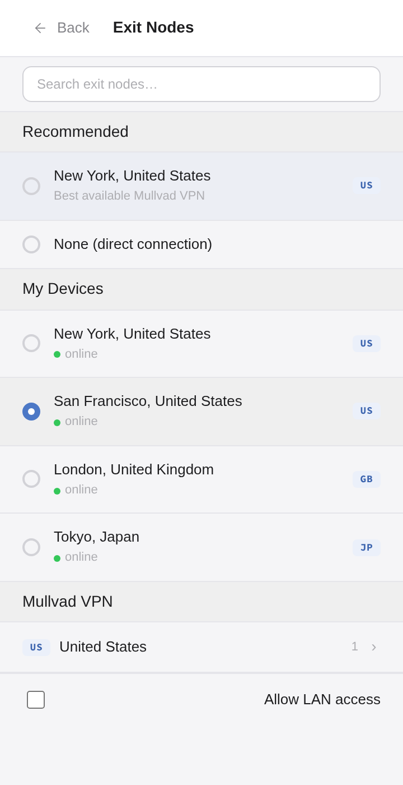

# Tailchrome

Access your Tailscale network from the browser. You do not need the system VPN.

<p align="center">
  
</p>

[Chrome Web Store](https://chromewebstore.google.com/detail/tailchrome/bhfeceecialgilpedkoflminjgcjljll) | [Firefox Add-ons](https://addons.mozilla.org/en-US/firefox/addon/tailchrome/) | [tesseras.org/tailchrome](https://tesseras.org/tailchrome/)

Tailchrome runs a full Tailscale node in each browser profile. It does not change system networking. Chrome, Firefox, and other Chromium browsers (Brave, Edge, Vivaldi, Opera, and Arc on macOS) share the same feature set. Tailnet traffic goes through a local SOCKS5/HTTP proxy, so the extension works with or without the Tailscale system app.

<p align="center">
  
  
</p>

## Features

- Each browser profile is its own Tailscale node and identity.
- Route all browser traffic through any exit node on your tailnet. The picker recommends "Best available Mullvad VPN" when one exists.
- Split-tunnel domains that bypass the exit node (for sites that block VPN traffic), or limit the exit node to a domain list you choose.
- MagicDNS resolves devices by name instead of IP.
- Split DNS resolves internal domains through restricted nameservers from Tailscale or Headscale ([setup and testing](docs/split-dns.md)).
- Subnet routing reaches IPv4 and IPv6 resources behind subnet routers.
- Switch between multiple Tailscale identities with profiles.
- The device list supports one-click IP copy, search, and a "View all" link.
- Routing status shows whether browser routing is active, blocked, or unavailable, separate from node connection state.
- Point a profile at a self-hosted control server such as Headscale.
- Keep the UI docked while you browse with the side panel (Chrome side panel, Firefox sidebar).
- Optional auto-connect brings the tailnet up when the browser starts.
- Shields Up blocks incoming connections.

## How it works

Two parts:

- A Manifest V3 browser extension (Chrome and Firefox) sets the proxy and provides the popup UI.
- A Go native host using `tsnet` runs the Tailscale node and serves a local proxy.

They talk over the browser native messaging protocol. See [full documentation](docs/DOCUMENTATION.md).

### Side panel mode

By default, the toolbar icon opens a popup that closes when you click away. Turn on **Open as side panel** in quick settings to keep the UI open.

- **Chrome:** The side panel stays open until you close it. Chrome keeps the service worker alive while the panel is visible, so peer updates arrive sooner.
- **Firefox:** The toolbar opens Tailchrome in the sidebar. Use the same toggle inside the sidebar to return to popup mode.

The UI is the same in either surface.

## Install

1. Install from the [Chrome Web Store](https://chromewebstore.google.com/detail/tailchrome/bhfeceecialgilpedkoflminjgcjljll) (Brave, Edge, Vivaldi, Opera, and Arc on macOS use the same listing) or [Firefox Add-ons](https://addons.mozilla.org/en-US/firefox/addon/tailchrome/).
2. Open the extension and follow helper setup for your platform. Per-user scripts and the popup-guided installers do not need admin rights. The [Homebrew cask](packaging/homebrew/README.md) and some system packages do.
3. Log in to Tailscale.

Install the helper from the same [release](https://github.com/dantraynor/tailchrome/releases/latest) as the extension (minimum helper **v0.1.14** for the authenticated proxy). Pairing rules, repair, pinning, Flatpak, and uninstall are in [helper installation](docs/helper-installation.md).

**Quick install** (macOS/Linux):

```bash
curl -fsSL https://github.com/dantraynor/tailchrome/releases/latest/download/tailchrome-install.sh | bash
```

**Quick install** (Windows PowerShell):

```powershell
irm https://github.com/dantraynor/tailchrome/releases/latest/download/tailchrome-install.ps1 | iex
```

**Other install paths:** [Homebrew tap](packaging/homebrew/README.md), [macOS](packaging/macos/README.md) and [Linux](packaging/linux/README.md) packages, [Windows](packaging/windows/README.md) MSI and raw helpers. Release checksums, attestation, and publication gates are in the [release checklist](docs/RELEASE_CHECKLIST.md).

## Windows code signing

SignPath Foundation accepted Tailchrome for Windows Authenticode signing. [Test signing](https://github.com/dantraynor/tailchrome/actions/runs/37815038448) passed; production certificate issuance and signed release integration are still pending. Windows releases stay explicitly unsigned until that work ships. See the [Windows code-signing policy](docs/WINDOWS_CODE_SIGNING_POLICY.md) and [SignPath setup notes](docs/signpath-setup.md).

For releases signed through the SignPath Foundation program:

> Free code signing provided by SignPath.io, certificate by SignPath Foundation

## Development

```
pnpm install --frozen-lockfile
make dev              # Chrome extension (watch mode)
make host             # Native host binary
```

See [CONTRIBUTING.md](docs/CONTRIBUTING.md) for CI, release workflow, and build commands.

## Contributing

Bug reports and feature requests are welcome. Open an issue before a PR so we can agree on approach. See [CONTRIBUTING.md](docs/CONTRIBUTING.md).

## License

MIT
